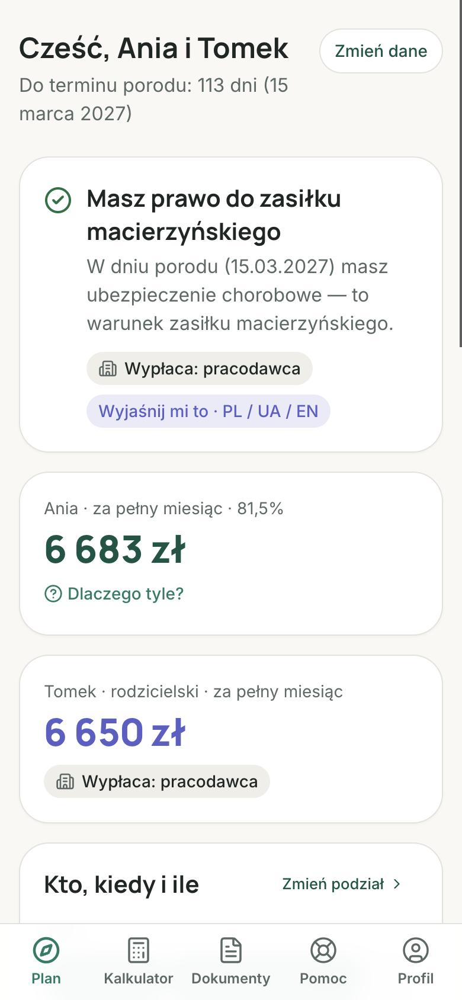
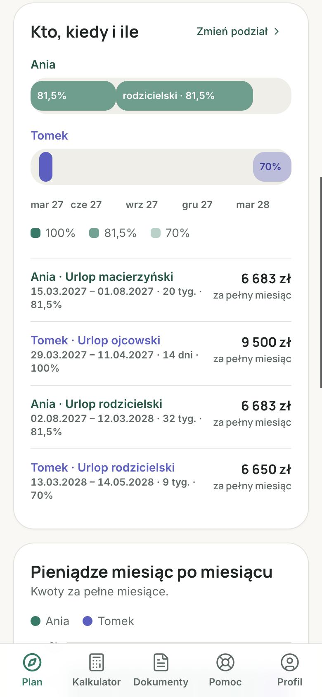
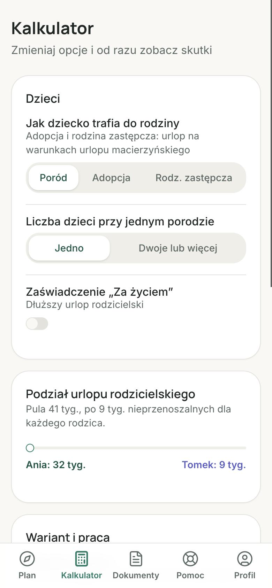
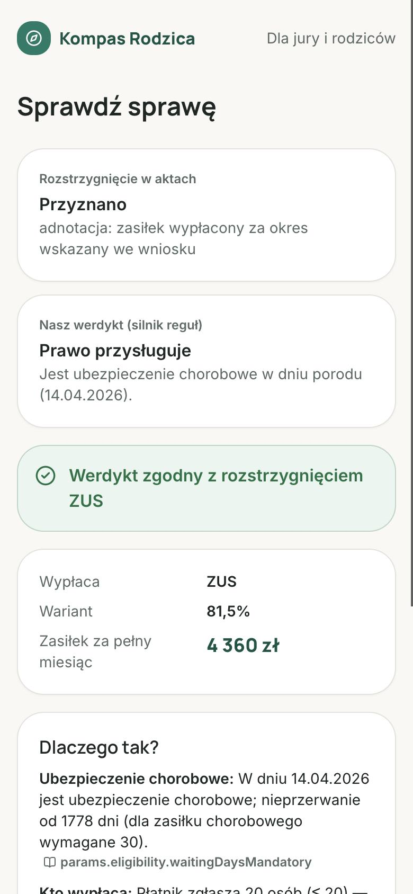

# Kompas Rodzica

**Zasiłkowy Przewodnik Przyszłego Rodzica** — HackNation 2026, wyzwanie ZUS.

Mobilny przewodnik (RWD / PWA) dla przyszłych rodziców: w 3 minuty pokazuje, czy masz prawo
do zasiłku, kto go wypłaci (pracodawca czy ZUS), ile i kiedy dostanie każde z rodziców,
jak podzielić urlopy, jakie dokumenty złożyć i gdzie — oraz na co uważać.

> **AI rozumie i tłumaczy — silnik reguł liczy.** Kwoty, okresy i terminy liczy
> deterministyczny silnik w `lib/engine/` (testy Vitest). AI tylko czyta dokumenty i wyjaśnia wynik.
> To informacja, a nie decyzja ZUS.

## Demo

- **Aplikacja:** https://kompas-rodzica.vercel.app
- **Panel administracyjny:** https://kompas-rodzica.vercel.app/admin (hasło: `KompasJury2026`)
- **Film (2:45):** https://youtu.be/pdhRhq2WKN0
- **Kod:** https://github.com/oleksandr-bortec/kompas-rodzica

| Plan | Kto, kiedy i ile | Kalkulator | Sprawdź sprawę |
|---|---|---|---|
|  |  |  |  |

Wersja demonstracyjna jest publikowana automatycznie na Vercel z gałęzi `main`
(każdy PR dostaje własny podgląd). Dane osób w demo są fikcyjne, a imitacje systemów
(mObywatel, ZUS, e-ZLA, PUE/eZUS) mają oznaczenie „Symulacja”.

## Panel administracyjny (dla jury)

1. Otwórz https://kompas-rodzica.vercel.app/admin i wpisz hasło demo: **`KompasJury2026`**.
2. W tabeli parametrów wpisz nową wartość, np. `combinedRate.ratePercent` = `80` (zamiast 81,5%).
3. Ustaw datę wejścia w życie, np. `2027-01-01`, i kliknij „Zapisz nową wersję”.
4. Otwórz **Plan** (profil Ania i Tomek, poród 15.03.2027): kwota zmienia się z 6 683 zł na 6 560 zł,
   a etykiety pokazują 80% — plany ze zdarzeniem od tej daty liczą się z nowej wersji.
5. „Przywróć parametry z kodu” usuwa wersje zapisane w panelu.

W demo nowe wersje zapisują się tylko w Twojej przeglądarce (nie zmieniają aplikacji innym osobom),
dlatego hasło demo może być jawne. W produkcji: baza danych za REST API z dziennikiem zmian i rolami.

## Uruchomienie lokalnie

```bash
npm install
npm run dev        # http://localhost:3000
npm test           # testy silnika reguł
npm run build      # build produkcyjny
```

Wymagany Node.js ≥ 20.9 (zalecany 22, patrz `.nvmrc`).

## Deploy na Vercel

1. Zaloguj się na [vercel.com](https://vercel.com) kontem GitHub.
2. **Add New → Project → Import** repozytorium `kompas-rodzica`.
3. Framework: **Next.js** (wykrywany automatycznie). Nic więcej nie trzeba zmieniać.
4. **Environment Variables:** dodaj `ADMIN_PASSWORD` (hasło do `/admin`).
   `ANTHROPIC_API_KEY` — klucz Claude API do odczytu akt w „Sprawdź sprawę” (bez niego działają przykładowe sprawy).
5. **Deploy.** Każdy push do `main` aktualizuje produkcję, a każdy PR dostaje własny podgląd.

## Struktura

| Ścieżka | Co tam jest |
|---|---|
| `app/` | ekrany (App Router), `app/api/*` — REST API |
| `lib/engine/` | silnik reguł + `params/*.json` (parametry z datą wejścia w życie) |
| `lib/personas/` | dane demo: Ania i Tomek, Kasia, Ola, Ewa i Marek |
| `lib/mocks/` | imitacje (mObywatel, ZUS, e-ZLA, PUE/eZUS) — w UI z badge „Symulacja” |
| `tests/cases/` | testy end-to-end na sprawach |
| `docs/ai-usage.md` | jak AI było użyte w aplikacji i w tworzeniu kodu |

## REST API

| Metoda | Ścieżka | Opis |
|---|---|---|
| `POST` | `/api/calculate` | pełny plan: prawo, płatnik, okresy, kwoty, terminy, ryzyka, trace |
| `POST` | `/api/eligibility` | tylko prawo do zasiłku i kto wypłaca |
| `GET` | `/api/params?date=RRRR-MM-DD` | parametry obowiązujące w danym dniu |
| `POST` | `/api/cases/extract` | PDF akt (multipart, pole `file`, do 4 MB) → dane odczytane przez AI do potwierdzenia (wymaga `ANTHROPIC_API_KEY`) |
| `POST` | `/api/explain` | `{ input, lang: pl\|uk\|en, names }` → akapity wyjaśnienia z `{placeholderami}` zamiast liczb (bez klucza: 503 i wyjaśnienie z szablonu) |
| `GET` / `POST` / `DELETE` | `/api/admin/login` | stan sesji / logowanie hasłem `ADMIN_PASSWORD` / wylogowanie (cookie HttpOnly) |

Błędne dane wejściowe → `400` z opisem po polsku (np. `GET /api/params?date=abc`).

## Biblioteki i licencje

Wszystkie rozwiązania zewnętrzne (biblioteki, fonty, usługi) i ich licencje: [docs/biblioteki.md](docs/biblioteki.md).

## Zasady dla zespołu i agentów AI

Przeczytaj [AGENTS.md](AGENTS.md). Najważniejsze: każdy pracuje na swojej gałęzi i robi PR do
`main`; przykładowych spraw ZUS (`zus-samples/`) ani kluczy API nigdy nie commitujemy.
